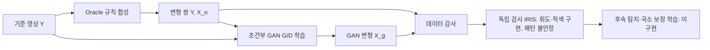

# LUMI — 시공간 국소 보정 연구를 위한 영상 데이터 생성 실험실

> **현재 상태: 데이터 생성·GAN 프로토타입 + IRIS 라벨링 1차 구현 · 2026-11-05**  
> 개인 연구 저장소(GAN·학습 데이터 합성·IRIS 라벨링): `lumi-vision/lumi-lab-ryujungho2-collab` · 팀 통합 저장소: `lumi-vision/lumi` · 협업 방법: [docs/COLLABORATION.md](docs/COLLABORATION.md)

**LUMI는 영상 전체를 무조건 흐리게 만들지 않고, 광과민성 관련 위험 특성이 나타나는 시공간적 영역에만 최소한으로 개입하는 보정 기술을 연구하는 프로젝트**다. 이 저장소는 최종 보정기가 아니라 **학습 데이터를 어떻게 생성·검증해야 하는지**를 다루는 개인 실험용 코드와 연구 문서를 보관한다.

> **주의:** 생성 데이터에는 광과민성 관련 유해 시각 자극이 포함될 수 있다. 합성 영상은 자동 재생하거나 미리보기하지 않는다. 현재 코드에는 독립적인 표준 기반 위험 검사기나 임상 안전성 검증이 없으며, 합성 데이터에 대해 '안전하다', '위험하다', '발작을 예방한다'고 주장할 수 없다. `lumi preview`는 기본 차단되어 있고, **이미 검토한 비위험 소스에서만** 사용한다.

## 연구 질문과 선택 근거

Barbu, Banda & Katz (2020)는 영상에 변형을 가해 원본–변형본 학습 쌍을 만드는 **Forward**와, 이를 되돌리는 **Inverse** 학습을 분리한다. Forward에서 규칙 생성기 또는 GAN을 활용하고 GAN에는 광과민성 관련 미분 가능한 평가 손실도 도입했다. LUMI는 이 원리를 참고해 **변형할 영역과 시간 조건이 기록된 데이터**를 우선 구축한다. 단, 여기 구현된 조건부 3D PatchGAN은 **Barbu 원논문의 완전 재현이 아니다**. 위험 평가 CNN 손실은 아직 구현하지 않았다.

**핵심 질문:** `Oracle-only`와 `Oracle+GAN` 중 어떤 데이터가 후속 위험 탐지 및 국소 보정의 **비합성 외부 시험셋** 성능을 더 개선하는가? 개선이 없다면 GAN을 필수 구성 요소로 삼지 않는다.



## 현재 구현 / 아직 구현되지 않은 것

| 구분 | 상태 | 코드/근거 |
|---|---|---|
| OpenCV/PyAV 영상 읽기와 프레임 로그 | 구현 | `src/lumi/video_io.py`, `analysis.py` |
| 기본 차단되는 수동 플레이어 | 구현 | `src/lumi/player.py` |
| 원본–변형본, ROI 허용 마스크와 시간 파형 생성 (구간별 주파수·세기 변화 포함) | 구현 | `src/lumi/dataset_synthesis.py` |
| IRIS 입력용 무손실 FFV1/MKV 저장 (왕복 바이트 일치 확인) | 구현 | `src/lumi/lossless_video.py` |
| IRIS(EA) 실행·결과 해석·manifest 기록, 라벨러 확인 시험 | 구현 | `src/lumi/iris_labeling.py`, `scripts/label_iris.py`, `scripts/iris_selftest.py` |
| 조건부 3D CNN Generator/Discriminator 및 Hinge GAN 학습 | 구현 | `src/lumi/gan_synthesis.py` |
| 데이터 배열 형식·ROI 외 보존·원본 해시 기반 분할 감사 | 구현 | `src/lumi/dataset_audit.py` |
| IRIS 휘도·적색 판정 | **확인 시험 통과** | `docs/IRIS_LABELING_PLAN.md` 5.1절 |
| IRIS 패턴 판정 | **불안정 — 정답으로 쓰지 않음** | 같은 줄무늬가 몇 px 이동에 판정이 뒤집힘 (5.1절) |
| 공식 ITU/WCAG 적합성 판정, 위험 기여 마스크 | **미구현** | IRIS는 인증 도구가 아님 |
| GAN 학습 수렴/일반화, 국소 보정기, 60FPS 실시간성 | **미검증/미구현** | 실험 계획 참조 |

**코드 테스트:** `pytest -q` 실행 결과 **25 passed** (2026-11-05, 집 GPU PC RTX 5080 — 노트북에서는 CUDA 시험 1개가 skip). IRIS 관련 테스트는 실행 파일 없이 가짜 실행기로 돈다. 이 결과는 위험도·화질·실시간 처리 성능을 검증하지 않는다.

## 연구 문서 — 논문처럼 읽는 권장 순서

1. [연구 설계서 / 초록·문제 정의·연구 질문·근거](docs/RESEARCH_DESIGN.md)
2. [Barbu 원논문과 LUMI GAN의 구조·손실함수·차이 (요약)](docs/BARBU_GAN_REVIEW.md) · [상세 분석](docs/BARBU_GAN_DEEP_DIVE.md)
3. [데이터셋 구축 및 라벨 규약 — 팀원과의 데이터 규약](docs/DATASET_PROTOCOL.md)
4. [반증 가능한 가설과 비교 실험/통계 계획](docs/EXPERIMENT_PLAN.md)
5. [IRIS 라벨링 계획과 확인 시험 결과](docs/IRIS_LABELING_PLAN.md)
6. [구현 파일별 증거·미구현 목록·한계](docs/IMPLEMENTATION_AUDIT.md)
7. [문헌·국제 표준 링크](docs/REFERENCES.md) · [관련 연구: GAN·합성 데이터 사례](docs/RELATED_WORK.md)
8. [G(조건부 생성기) 실험 기록](docs/GAN_EXPERIMENTS.md)
9. [협업 안내: 무엇을 공유하나 · 노트북/GPU PC 설치 · 팀원 데이터 규약](docs/COLLABORATION.md)

## 시작하기 — Windows 11 / PowerShell

Python 3.11 이상과 Git이 필요하다. **저장소 폴더에는 커밋할 파일만 둔다.** venv·데이터는 저장소 옆 `..\_work`에 만든다(자세히: [COLLABORATION.md](docs/COLLABORATION.md)).

```powershell
mkdir C:\dev\lumi-vision; cd C:\dev\lumi-vision
git clone https://github.com/lumi-vision/lumi-lab-ryujungho2-collab.git
cd lumi-lab-ryujungho2-collab
.\setup_windows.ps1               # 노트북=CPU, NVIDIA GPU PC=cu132 자동 선택 · 진단과 테스트까지 실행
$py = "..\_work\.venv\Scripts\python.exe"
```

원본 데모는 유해한 점멸을 의도적으로 생성하지 않는 **소프트웨어 기능 테스트용** 영상이다. 임상적으로 무해함을 인증한 영상이라는 뜻은 아니다.

```powershell
& $py scripts\generate_demo.py --output ..\_work\sample\lumi_demo.avi
& $py scripts\build_dataset.py --source ..\_work\sample\lumi_demo.avi --output ..\_work\datasets\oracle --samples 20 --seed 42
& $py scripts\audit_dataset.py --dataset ..\_work\datasets\oracle
& $py scripts\train_gan.py --dataset ..\_work\datasets\oracle --epochs 20 --batch-size 2 --width 24 --checkpoint ..\_work\checkpoints\lumi_cgan.pt
```

`build_dataset.py`는 영상 소스가 복수일 때 `--source`를 반복 지정할 수 있다. IRIS 라벨용 6초 클립은 `--iris-clips`, 라벨링은 `scripts\label_iris.py`(GPU PC, IRIS 빌드 필요)로 한다. GPU 학습 옵션과 IRIS 설치는 [COLLABORATION.md](docs/COLLABORATION.md) 3·4절을 본다.

위 명령이 실행된다고 모델이 제대로 학습됐다거나 유효한 위험 학습 데이터가 확보되었다는 의미는 아니다. 외부 일반화 실험은 후속 과제다.

## 데이터 필드의 의미 — 혼동 금지

| 현재 필드 | 실제 의미 | 아닌 것 |
|---|---|---|
| `clean` | 변형 전 기준 RGB 클립 | 검증된 안전 영상이라는 보장 |
| `affected` | 합성한 변형 후보 RGB 클립 | 반드시 기준 위반인 영상 |
| `mask` | 변형을 **허용한** 영역 `M_allow` | 실제 변경 픽셀, 검증된 위험 마스크 |
| `activation` | 프레임별 변형 활성화 계수 | 위험 확률 |
| `type` | 합성 **조건** (normal/luminance/red/pattern) | 정답 라벨 |
| `risk_verified: true` | IRIS로 검사했다는 표시 | 위험하다/안전하다는 판정 |
| `risk_verified: false` | 검사하지 않았거나 IRIS 오류 | 위험하지 않다는 판정 |
| `standard_result` | `iris:…` 형식의 IRIS 판정, `iris_error`는 학습 제외 | 인증·임상 판정 |

기본 16프레임/24fps 클립은 약 0.667초이므로 1초 기반 사건 판정을 완결하지 못한다. 그래서 IRIS 라벨은 6초 클립(`--iris-clips`)에 붙이고, 학습 창(16프레임)의 라벨 규칙은 [IRIS 계획 6절](docs/IRIS_LABELING_PLAN.md)에서 정한다. 또한 OpenCV의 FPS 추정, 색전송함수, 화면 크기·휘도 등 실제 표시 환경을 별도로 다뤄야 한다.

## 개인 실험 → 팀 통합

이 저장소에서 원본·합성 데이터/체크포인트를 제외한 코드와 연구 근거를 관리한다. 위험 탐지 알고리즘은 팀원 담당이며, 팀원은 이 저장소의 데이터 규약([DATASET_PROTOCOL.md](docs/DATASET_PROTOCOL.md) 3절)을 쓴다. 재현성과 검증이 확보된 기능만 나중에 기능 브랜치와 Pull Request로 `lumi-vision/lumi`에 한 번에 옮긴다([COLLABORATION.md](docs/COLLABORATION.md) 7절).

## 핵심 문헌

- Barbu, A., Banda, D., & Katz, B. (2020). *Deep video-to-video transformations for accessibility with an application to photosensitivity.* https://doi.org/10.1016/j.patrec.2019.01.019
- Jordan, J. B. (2025). *Evaluating Conformance of Video Safety Tools for Photosensitive Epilepsy.* https://doi.org/10.1007/978-3-031-93848-1_7
- ITU-R BT.1702-3 (2023). https://www.itu.int/rec/R-REC-BT.1702-3-202311-I/en
- W3C WCAG 2.2 SC 2.3.1. https://www.w3.org/WAI/WCAG22/Understanding/three-flashes-or-below-threshold.html
