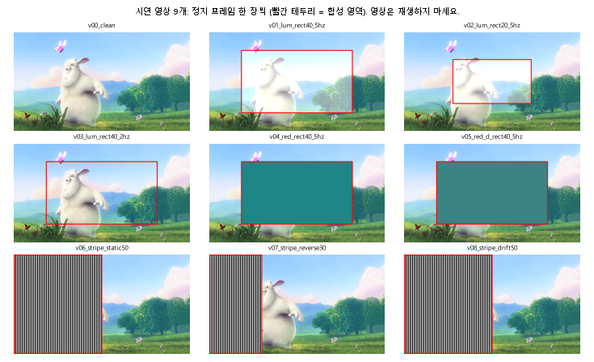

# 시연 영상 9개: 우리 판정기 대 팀원 판별기 (만들기 전 / 후)

> ⚠️ 이 문서는 2026-11-10 시점 기록입니다. 이후 기준 변경(11-12: 6쌍·움직임 무관 40%·흐름 제외 끔·1~10 cpd·규칙성, 11-13: 판정기 버그 6건 수정)은 ../../docs/STANDARDS.md 를 보세요.

> 만든 날 2026-11-10 · 영상: `scripts/make_demo_hazards.py` (Git 제외, `data/hazard_demo/`) · 평가: `scripts/eval_demo_hazards.py`
> 바탕: BBB 1080p 80초~, 960×540, 30 fps, 60프레임(2초), 1도당 29.1 px
> 팀원 판별기: lumi-lab-rockrovks `e29ba9b` `Fullscreen/A1/vdcoreops_v2.py` `evaluate_video_pse_risk` (수정 없이 기본 설정: laptop 56 cm, 15인치, 긴 변 720, 334 ms)
> ⚠️ 영상은 광과민성 위험 자극이라 재생하지 않았습니다. 아래 그림은 정지 프레임 한 장씩입니다.

| 영상 | 합성 내용 | 설계상 기대 | 우리: 휘도 | 우리: 휘도 무너진 조건 | 우리: 줄무늬 | 우리: 적색 | 팀원 판별기 |
|---|---|---|---|---|---|---|---|
| `v00_clean` | 원본(합성 없음) | 안전 | 안전 (0번/초, 면적 8%) | 면적 | 안전 (면적 11%, drifting) | 안전 (0번/초, 면적 0%, Δu′v′ 0.000) | 고대비 00.00s ~ 01.97s (60.40%); 줄무늬 패턴 00.13s ~ 01.87s (86.62%) |
| `v01_lum_rect40_5hz` | 휘도 깜빡임: 가운데 40%, 5 Hz, +60 cd/m² | 위험(휘도) | 위험 (5번/초, 면적 33%) | 없음 | 안전 (면적 11%, drifting) | 안전 (0번/초, 면적 0%, Δu′v′ 0.000) | 고대비 00.00s ~ 01.97s (59.75%); 줄무늬 패턴 00.13s ~ 01.87s (86.86%) |
| `v02_lum_rect20_5hz` | 휘도 깜빡임: 가운데 20%, 5 Hz (면적 미달) | 안전 | 안전 (0번/초, 면적 19%) | 면적 | 안전 (면적 11%, drifting) | 안전 (0번/초, 면적 0%, Δu′v′ 0.000) | 고대비 00.00s ~ 01.97s (60.17%); 줄무늬 패턴 00.10s ~ 01.87s (86.78%) |
| `v03_lum_rect40_2hz` | 휘도 깜빡임: 가운데 40%, 2 Hz (횟수 미달) | 안전 | 안전 (2번/초, 면적 33%) | 없음 | 안전 (면적 11%, drifting) | 안전 (0번/초, 면적 0%, Δu′v′ 0.000) | 고대비 00.00s ~ 01.97s (59.79%); 줄무늬 패턴 00.13s ~ 01.87s (86.96%) |
| `v04_red_rect40_5hz` | 적색 깜빡임: 40%, 5 Hz, Δu′v′ 0.2046 | 위험(적색) | 안전 (0번/초, 면적 3%) | 면적 | 안전 (면적 8%, drifting) | 위험 (5번/초, 면적 40%, Δu′v′ 0.205) | 위험 구간 없음 |
| `v05_red_d_rect40_5hz` | 적색 깜빡임: 40%, 5 Hz, Δu′v′ 0.1948 (색 차이 미달) | 안전 | 안전 (0번/초, 면적 3%) | 면적 | 안전 (면적 8%, drifting) | 안전 (0번/초, 면적 0%, Δu′v′ 0.000) | 위험 구간 없음 |
| `v06_stripe_static50` | 줄무늬 정지: 왼쪽 50%, 2.4 cpd | 위험(줄무늬, > 40%) | 안전 (0번/초, 면적 3%) | 면적 | 위험 (면적 58%, static) | 안전 (0번/초, 면적 0%, Δu′v′ 0.000) | 고대비 00.00s ~ 01.97s (78.32%); 줄무늬 패턴 00.00s ~ 01.97s (91.67%) |
| `v07_stripe_reverse30` | 줄무늬 명암 반전 5 Hz: 왼쪽 30%, 2.4 cpd | 위험(줄무늬, > 25%) | 안전 (0번/초, 면적 21%) | 면적 | 위험 (면적 39%, reversing) | 안전 (0번/초, 면적 0%, Δu′v′ 0.000) | 고대비 00.00s ~ 01.97s (74.64%); 줄무늬 패턴 00.00s ~ 01.97s (90.58%) |
| `v08_stripe_drift50` | 줄무늬 한 방향 흐름 3 px/프레임: 왼쪽 50%, 2.4 cpd | 제외(ITU: 매끄러운 흐름) | 위험 (15번/초, 면적 28%) | 없음 | 안전 (면적 58%, drifting) | 안전 (0번/초, 면적 0%, Δu′v′ 0.000) | 고대비 00.00s ~ 01.97s (78.30%); 줄무늬 패턴 00.00s ~ 01.97s (91.66%) |

팀원 결과 원본: [team_results.csv](team_results.csv)

| 영상 | 우리 판정 시간(초) | 팀원 판정 시간(초) |
|---|---|---|
| `v00_clean` | 29.9 | 0.7 |
| `v01_lum_rect40_5hz` | 29.9 | 0.6 |
| `v02_lum_rect20_5hz` | 29.7 | 0.6 |
| `v03_lum_rect40_2hz` | 30.0 | 0.6 |
| `v04_red_rect40_5hz` | 28.9 | 0.7 |
| `v05_red_d_rect40_5hz` | 29.3 | 0.6 |
| `v06_stripe_static50` | 63.0 | 0.4 |
| `v07_stripe_reverse30` | 47.7 | 0.4 |
| `v08_stripe_drift50` | 63.3 | 0.4 |
