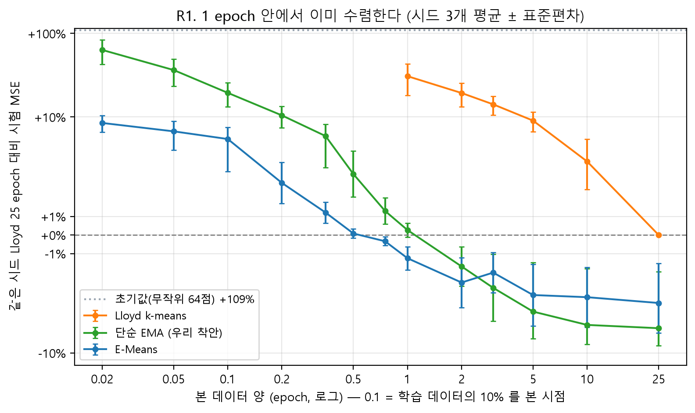
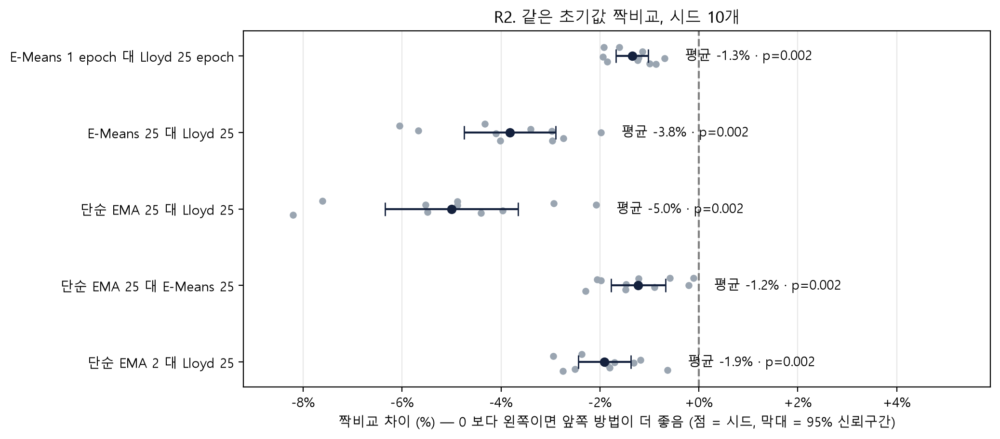

# E-Means 검증 보강: 학습 곡선과 시드 10개 짝비교 (2026-11-12)

> 데이터·분할·초기값은 노트북과 같음. 학습 1,858,464 / 시험 463,968 패치, K = 64, CPU. 스크립트 `scripts/emeans_rigor.py`. 기준 = 같은 시드 Lloyd 25 epoch 의 시험 MSE.

## 1 epoch 의 의미가 방법마다 다르다

- Lloyd: 1 epoch = 중심 갱신 1번. 단순 EMA: 1 epoch = 갱신 454번(배치 4096). E-Means: 1 epoch = 갱신 약 113번(법칙이 고른 배치 16,384) + 마지막 평균 확정.
- 그래서 E-Means 는 '처음부터 낮은' 것이 아니라 첫 epoch 안에서 이미 수렴한다. R1 의 0.02~1 epoch 구간이 그 과정.

## 짝비교 (같은 초기값, 시드 10)

| 비교                              |   n |   평균 차이(%) | 95% CI         | 음수인 시드   |   Wilcoxon p |
|:----------------------------------|----:|---------------:|:---------------|:--------------|-------------:|
| E-Means 1 epoch 대 Lloyd 25 epoch |  10 |          -1.35 | [-1.67, -1.02] | 10/10         |        0.002 |
| E-Means 25 대 Lloyd 25            |  10 |          -3.82 | [-4.74, -2.90] | 10/10         |        0.002 |
| 단순 EMA 25 대 Lloyd 25           |  10 |          -5    | [-6.34, -3.65] | 10/10         |        0.002 |
| 단순 EMA 25 대 E-Means 25         |  10 |          -1.23 | [-1.78, -0.68] | 10/10         |        0.002 |
| 단순 EMA 2 대 Lloyd 25            |  10 |          -1.91 | [-2.43, -1.38] | 10/10         |        0.002 |

