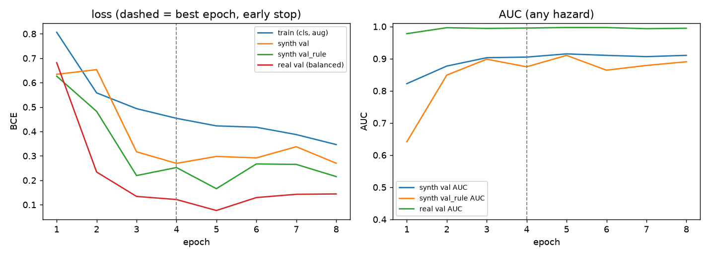

# HazNet `b` — G 데이터로 학습, 실제 위험 영상으로 검증·시험

> 2026-11-18 00:01 · `scripts/train_hazcls.py` · 매개변수 46.7k · 학습 2700개(합성만) · 감시 `synth` · 인내 4 · 최대 40 epoch · 증강 회전 ±25.0° · 화질 켬 · aux 1.0

- 돌린 epoch 8 · **가장 좋은 epoch 4** (감시 손실 0.2694)

## 검증 (가장 좋은 epoch)

| 검증 세트 | 손실 | 아무 위험 AUC | 휘도 AUC | 적색 AUC | 무늬 AUC |
|---|---|---|---|---|---|
| 합성 val | 0.2694 | 0.905 | 0.9162 | 0.9825 | 0.9423 |
| 합성 val_rule | 0.2523 | 0.8748 | 0.951 | 0.9271 | 0.9912 |
| 실제 val (Kaya 16 · South 안전 298) | 0.1213 (균형) | 0.9954 | – | – | – |

## 실제 영상 test (학습·조기 종료에 쓰지 않음)

영상 763개 (위험 169: South 163 + Kaya 6 · 안전 594: South). 문턱은 실제 val 에서 정함 = 0.3458

| 지표 | 문턱 0.5 | 문턱(val) |
|---|---|---|
| 민감도 (위험을 위험으로) | 0.2367 | 0.2781 |
| 특이도 (안전을 안전으로) | 0.9697 | 0.9646 |
| AUC | 0.7647 | |

| 종류 (데이터셋 라벨) | 개수 | 아무 머리라도 위험 | 해당 머리가 위험 |
|---|---|---|---|
| flash | 94 | 0.3723 | 0.3404 |
| red | 12 | 0.3333 | 0.0833 |
| pattern | 67 | 0.1343 | 0.0896 |
| kaya | 6 | 1.0 | – |

같은 영상에서 판정기와 비교 (판정 결과가 있는 영상만):

| 비교 대상 | 영상 수 (위험) | 판정기 민감도 / 특이도 | HazNet 민감도 / 특이도 |
|---|---|---|---|
| 우리 판정기 | 763 (169) | 0.0651 / 0.9983 | 0.2781 / 0.9646 |
| 팀원 판별기 (B2) | 763 (169) | 0.6154 / 0.5556 | 0.2781 / 0.9646 |

## Kaya 원본 대 Kaya 보정본 (같은 파일의 두 쪽, 같은 처리 · 정답 없음)

짝 22개 · 평균 확률 원본 0.9933 → 보정본 0.9824 · 보정본 점수가 더 낮은 짝 55% · 0.5 이상: 원본 22 · 보정본 22

실제 val 양성이 Kaya 뿐이라 모델이 'Kaya 처럼 생긴 영상'을 배웠을 수 있다. 같은 영상의 보정 전·후에서 점수가 떨어지면 생김새가 아니라 깜빡임을 본다는 근거가 된다.

## 주의

- 실제 영상 정답은 데이터셋 라벨이다(South: 저자 라벨 위험·깜빡임·적색·패턴, Kaya: 'PSE 유발' 데이터셋이라 전부 위험). 우리 판정 기준과 정의가 다르다.
- 실제 영상 검증 양성은 Kaya 16개뿐이다 — 조기 종료가 이 16개에 맞춰질 수 있다. test 는 이와 겹치지 않는다.
- 실제 영상은 2초 창(최대 South 8개 · Kaya 60개)으로 잘라 창 중 최대를 영상 확률로 썼다. 24 fps 로 다시 뽑아 12 Hz 넘는 깜빡임은 겹쳐 보일 수 있다.
