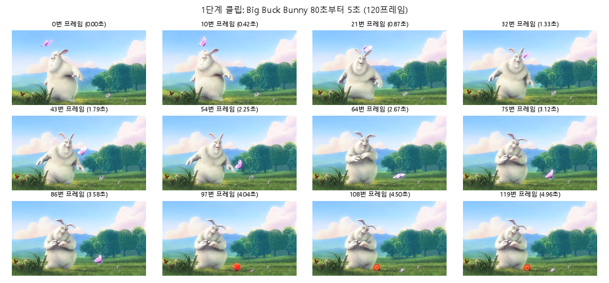
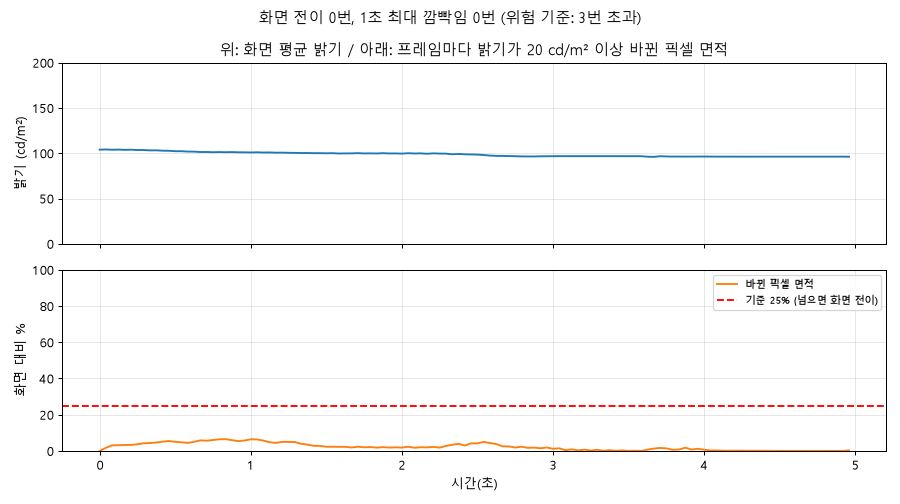

> ⚠️ **옛 결과입니다 (640×358, 24fps 기준).** PLAN 개정 2판에 따라 1단계는 1080p·30fps로 다시 할 예정이고, `scripts/step1_cut.py`도 아직 고치기 전입니다.

# 1단계 점검표: 원본 5초 클립

**결과: ✅ 통과** (5/5 항목 통과)

## 만든 것

- 클립: `data/clips/bbb_clip01.mkv` (Git에 안 올림). Big Buck Bunny **80초~85초**, 640×358, 24.00 fps, 120프레임, FFV1 무손실
- 원본 세로가 359px(홀수)이라 맨 아래 1줄을 잘라 358px로 맞췄습니다.

## 점검 (저장한 파일을 다시 읽어서 ITU-R BT.1702 방식으로 측정)

| 항목 | 결과 | 통과 |
|---|---|---|
| 저장 후 프레임 수 | 120 (기대 120) | ✅ |
| 원본과 픽셀 차이 | 최대 0 (0이면 무손실) | ✅ |
| 1초 최대 깜빡임 | 0번 (원본이므로 0이어야 함) | ✅ |
| 가장 넓은 전이 면적 | 6.5% (기준 25% 이하) | ✅ |
| 평균 밝기 | 98.8 cd/m² (너무 어둡지 않게 20 이상) | ✅ |

측정 기준: 픽셀 밝기가 20 cd/m² 이상 바뀌고(어두운 쪽 160 미만) 그런 픽셀이 화면의 25%를 넘으면 화면 전이 1번, 전이 2번 = 깜빡임 1번, 1초에 3번 넘으면 위험. 자세한 설명은 `src/lumi_synth/measure.py` 맨 위.

## 직접 확인할 것

1. **[contact_sheet.png](contact_sheet.png)**: 12장이 같은 장면이 자연스럽게 이어지는 그림인지
2. **[luma.png](luma.png)**: 위 그래프가 완만하고, 아래 주황 선이 빨간 점선(25%) 아래에 있는지

## 참고: 훑어본 후보 구간

| 시작(초) | 1초 최대 깜빡임 | 가장 넓은 전이 면적 | 평균 밝기(cd/m²) | 선택 |
|---|---|---|---|---|
| 60 | 0.5 | 86.8% | 101.6 |  |
| 70 | 0.5 | 79.1% | 55.7 |  |
| 80 | 0 | 6.5% | 98.8 | ✅ |

만든 명령: `python scripts\step1_cut.py`
