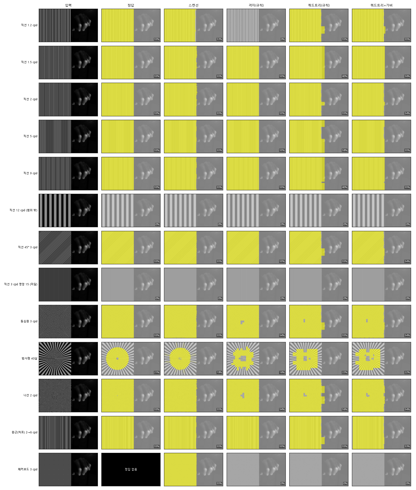

# 줄무늬 탐지 비교: 스캔선 대 주파수(FFT·DCT) + E-Means

> 만든 날 2026-11-13 · 스크립트 `scripts/eval_stripe_freq.py` · 탐지기 `src/lumi_synth/stripe_freq.py`
> 해상도 384×216(1도 11.6 px, 패치 24 px) · 규칙 상수는 measure.py 와 같음(cpd (1.0, 10.0), 6쌍, 면적 > 40%)
> 정지 그림 한 장씩 판정(움직임·지속 조건 제외). 시험 바탕(Elephants Dream)과 합성 seed 는 E-Means 학습(BBB, seed 0)과 다름.

## 1. 경우별 면적 (정답 / 방법별, 굵게 = 40% 판정이 정답과 다름)

### 바탕: 회색 60

| 경우 | 정답 | 스캔선 | 주파수(규칙) | 주파수+E-Means | 쿼드트리(규칙) | 쿼드트리+E-Means | 쿼드트리+가버 |
|---|---|---|---|---|---|---|---|
| 직선 1.2 cpd | 55% | 55% (IoU 1.00) | **0% (IoU 0.00)** | **0% (IoU 0.00)** | 60% (IoU 0.92) | 60% (IoU 0.92) | 56% (IoU 0.98) |
| 직선 1.5 cpd | 55% | 55% (IoU 1.00) | 55% (IoU 1.00) | 55% (IoU 1.00) | 60% (IoU 0.92) | 60% (IoU 0.92) | 56% (IoU 0.98) |
| 직선 2 cpd | 55% | 55% (IoU 1.00) | 55% (IoU 1.00) | 55% (IoU 1.00) | 57% (IoU 0.97) | 57% (IoU 0.97) | 55% (IoU 0.99) |
| 직선 5 cpd | 55% | 55% (IoU 1.00) | 55% (IoU 1.00) | 55% (IoU 1.00) | 57% (IoU 0.97) | 57% (IoU 0.97) | 55% (IoU 1.00) |
| 직선 9 cpd | 55% | 55% (IoU 1.00) | 55% (IoU 1.00) | 55% (IoU 1.00) | 57% (IoU 0.97) | 57% (IoU 0.97) | 55% (IoU 0.99) |
| 직선 12 cpd (범위 밖) | 0% | 0% | 0% | 0% | 0% | 0% | 0% |
| 직선 45° 3 cpd | 55% | 55% (IoU 1.00) | 55% (IoU 1.00) | 58% (IoU 0.95) | 57% (IoU 0.97) | 57% (IoU 0.97) | 55% (IoU 0.99) |
| 직선 3 cpd 명암 15 (미달) | 0% | 0% | 0% | 0% | 0% | 0% | 0% |
| 동심원 3 cpd | 55% | 55% (IoU 0.99) | 54% (IoU 0.98) | 58% (IoU 0.95) | 57% (IoU 0.96) | 57% (IoU 0.97) | 55% (IoU 0.99) |
| 방사형 40살 | 21% | 19% (IoU 0.87) | 16% (IoU 0.70) | 16% (IoU 0.72) | 22% (IoU 0.72) | 22% (IoU 0.72) | 22% (IoU 0.70) |
| 나선 2 cpd | 55% | 55% (IoU 0.99) | 54% (IoU 0.98) | 55% (IoU 0.98) | 56% (IoU 0.96) | 56% (IoU 0.96) | 54% (IoU 0.97) |
| 원근(처프) 2→6 cpd | 55% | 55% (IoU 1.00) | 55% (IoU 1.00) | 55% (IoU 1.00) | 60% (IoU 0.92) | 60% (IoU 0.92) | 54% (IoU 0.98) |
| 체커보드 3 cpd | – | 55% | 0% | 0% | 0% | 0% | 0% |

### 바탕: ED 장면

| 경우 | 정답 | 스캔선 | 주파수(규칙) | 주파수+E-Means | 쿼드트리(규칙) | 쿼드트리+E-Means | 쿼드트리+가버 |
|---|---|---|---|---|---|---|---|
| 직선 1.2 cpd | 55% | 53% (IoU 0.96) | **0% (IoU 0.00)** | **0% (IoU 0.00)** | 55% (IoU 0.97) | 55% (IoU 0.97) | 55% (IoU 0.98) |
| 직선 1.5 cpd | 55% | 55% (IoU 0.99) | 55% (IoU 1.00) | 55% (IoU 1.00) | 60% (IoU 0.92) | 60% (IoU 0.92) | 56% (IoU 0.99) |
| 직선 2 cpd | 55% | 55% (IoU 0.99) | 55% (IoU 1.00) | 55% (IoU 1.00) | 55% (IoU 0.97) | 55% (IoU 0.97) | 54% (IoU 0.98) |
| 직선 5 cpd | 55% | 55% (IoU 0.99) | 55% (IoU 1.00) | 55% (IoU 1.00) | 58% (IoU 0.94) | 58% (IoU 0.94) | 55% (IoU 0.99) |
| 직선 9 cpd | 55% | 55% (IoU 0.99) | 55% (IoU 1.00) | 55% (IoU 1.00) | 60% (IoU 0.92) | 60% (IoU 0.92) | 55% (IoU 0.99) |
| 직선 12 cpd (범위 밖) | 0% | 0% | 0% | 0% | 0% | 0% | 0% |
| 직선 45° 3 cpd | 55% | 55% (IoU 1.00) | 55% (IoU 1.00) | 55% (IoU 1.00) | 55% (IoU 0.97) | 55% (IoU 0.97) | 54% (IoU 0.98) |
| 직선 3 cpd 명암 15 (미달) | 0% | 0% | 0% | 0% | 0% | 0% | 0% |
| 동심원 3 cpd | 55% | 55% (IoU 0.99) | 54% (IoU 0.99) | 55% (IoU 0.99) | 55% (IoU 0.96) | 55% (IoU 0.97) | 54% (IoU 0.97) |
| 방사형 40살 | 21% | 19% (IoU 0.87) | 16% (IoU 0.70) | 16% (IoU 0.72) | 22% (IoU 0.72) | 22% (IoU 0.72) | 22% (IoU 0.70) |
| 나선 2 cpd | 55% | 55% (IoU 0.99) | 54% (IoU 0.98) | 54% (IoU 0.99) | 56% (IoU 0.95) | 56% (IoU 0.95) | 54% (IoU 0.97) |
| 원근(처프) 2→6 cpd | 55% | 55% (IoU 0.99) | 55% (IoU 1.00) | 55% (IoU 1.00) | 55% (IoU 0.97) | 55% (IoU 0.97) | 53% (IoU 0.97) |
| 체커보드 3 cpd | – | 55% | 0% | 0% | 0% | 0% | 0% |

## 2. 요약

| 방법 | 40% 판정 일치 (정답 있는 경우) | 평균 IoU | 자연 영상 10장 오탐 면적 최대 / 평균 | 한 장 평균 시간 |
|---|---|---|---|---|
| 스캔선 | 24/24 | 0.98 | 1.6% / 0.3% | 1.19초 |
| 주파수(규칙) | 22/24 | 0.86 | 0.0% / 0.0% | 0.06초 |
| 주파수+E-Means | 22/24 | 0.86 | 0.3% / 0.0% | 0.06초 |
| 쿼드트리(규칙) | 24/24 | 0.93 | 0.9% / 0.1% | 0.05초 |
| 쿼드트리+E-Means | 24/24 | 0.93 | 1.3% / 0.2% | 0.05초 |
| 쿼드트리+가버 | 24/24 | 0.95 | 0.6% / 0.1% | 0.17초 |

## 3. E-Means 군집

- 구현: 논문 식 2·5·6·7·부록 H.1 을 numpy 로 직접 구현(공식 faiss 구현 아님). K = 32, 5 epoch, 법칙이 고른 B = 2229, α₀ = 1.000, 저장된 모델(data/stripe_freq/emeans_model.npz)을 다시 씀.
- 학습 패치의 합성 줄무늬 비율이 50% 이상인 '줄무늬 군집' 8개.
- 학습과 다른 패치(ED 배경·seed 1)에서 '줄무늬 군집 = 줄무늬' 로 보면 정밀도 0.71, 재현율 0.92.
- 쓰임: 줄무늬 군집의 패치는 봉우리 집중도 문턱을 0.5 → 0.3 로 낮춰 인정한다(곡선·방사·원근 줄무늬용).

## 4. 한계

- 정답 마스크는 합성 조건에서 계산한 것이다. 생성기와 탐지기가 같은 규칙 상수를 쓰므로 '규칙을 제대로 구현했는가'만 보여 준다.
- 패치가 영역 경계에 걸치면 경계 밖까지 줄무늬로 칠한다(패치 절반 크기만큼 면적이 넓어질 수 있음).
- 체커보드는 둘째 봉우리 조건으로 주파수 방식에서 빠진다. 스캔선 방식은 센다. 어느 쪽이 맞는지는 기준 해석 문제다.
- 정지 그림만 비교했다. 움직임·지속 조건과 실제 줄무늬 영상(옷·블라인드·에스컬레이터)은 아직 시험하지 않았다.
- 문턱(RHO_MIN·RHO_LOOSE·RHO2_MAX·패치 크기, 쿼드트리 QT_UNIFORM·QT_SPLIT_RHO, 가버 QT_REFINE_REL)은 이 생성기와 BBB·ED 에서 정한 구현 선택이다.
- '직선 12 cpd' 는 384×216 에서 주기가 약 1 px 이라 앨리어싱으로 넓은 줄(약 0.5 cpd)이 보인다. 정답 0% 는 우연히 맞다.

## 5. 해석 (손으로 쓴 절 — 스크립트를 다시 돌리면 1~4절만 새로 써지고 이 절은 지워지니 옮겨 둘 것)

- **고정 격자(2도 패치)는 1.2 cpd 를 놓친다**(0%): 패치에 2.5주기만 들어가 주파수를 1 cpd 미만으로 잰다.
- **쿼드트리는 24/24**, 가장 빠르다(0.05초). 8도 블록에서 시작해 낮은 주파수를 정확히 잰다. 대신 경계에 걸친 블록을 통째로 칠해
  면적이 넘친다(55% → 58~60%). 원인은 블록 모양이 아니라 '주파수를 재려면 두 주기 이상 필요한 블록 크기 하한'과 '블록 전체를
  칠하는 규칙'이다(같은 사각형인 고정 격자는 가까운 패치 중심을 따르는 규칙이라 넘치지 않았다).
- **쿼드트리 + 가버 다듬기: 24/24, 평균 IoU 0.95, 자연 영상 오탐 최대 0.6%, 0.17초.** 인정한 블록 안에서만 그 블록 주파수
  근처(×0.8·1·1.25)의 가버 필터 12방향 최대 응답으로 실제 줄무늬 픽셀만 남긴다. 직선·동심원·저주파 경계가 거의 정답과 맞는다
  (직선 IoU 0.97 → 0.99, 동심원 0.96 → 0.99, 1.2 cpd 0.92 → 0.98). 방향 하나로만 거르면 동심원 0.80·방사형 0.25 로 지워졌다.
- **방사형은 모든 주파수 방식이 약하다**(0.70~0.72, 스캔선 0.87): 중심으로 갈수록 주파수가 계속 높아져 블록·필터의 주파수 범위를 벗어난다.
- **E-Means 는 판정·면적을 바꾸지 못했다**(쿼드트리에서는 오탐만 늘림). 합성 시험에서는 규칙 문턱만으로 충분하다.
- 플레이어(`scripts/make_playlist.py`) 넷째 칸이 쿼드트리 + 가버 결과와 블록 테두리를 보여 준다. 시연 영상: `scripts/make_stripe_demo.py` → `data/stripe_demo/`.
