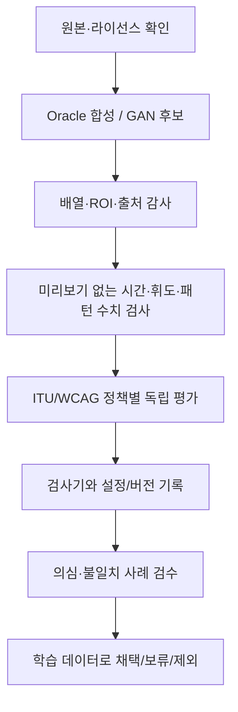

# LUMI 데이터셋 구축·주석·검증 규약 v0.3

## 1. 데이터 확보의 기본 명제

'많은 데이터'보다 중요한 것은 **어떤 샘플이 어떤 이유로 학습 정답이 되는지 설명할 수 있는 데이터**다. 본 프로젝트는 합성 파이프라인을 학습용 후보 생성기로 사용하고, 광과민성 기준 판정은 별도의 검증 작업으로 둔다. 이 원칙은 Barbu et al. [1]의 Forward 구조 및 Jordan [2]의 재현 가능한 시험 매체 연구에 근거한다.

## 2. 데이터 단위와 세 가지 공간 마스크

- `clip`: 시간적으로 인접한 프레임 묶음 `[T,H,W,3]` (RGB, uint8).
- `M_allow`: 변형을 허용한 범위. **현재 `mask`가 담는 정보.** 마스크가 1이라고 반드시 픽셀이 변하지는 않는다.
- `M_changed[t,p] = 1[X[t,p] != Y[t,p]]`: RGB 어느 채널이든 실제 값이 변한 위치. **코드에서 별도 저장하지 않음.**
- `M_risk`: 검증 프로토콜로 판정한 위험 이벤트의 공간적 기여 후보 영역. **아직 없음.** 기준에 따라 원래 단일한 '픽셀 수준 정답'이 존재하지 않을 수 있으므로 주석 정의, 검사기, 버전, 검수 상태를 함께 기록해야 한다.

`M_allow`, `M_changed`, `M_risk`를 하나의 `mask`로 합치면 서로 다른 학습 정답이 섞인다. 특히 생성기가 실제로 수정하지 않은 허용 영역을 모두 위험이라 표기하면 오탐을 구조적으로 학습시킬 수 있다.

## 3. V0 구현 데이터 명세 — 정확한 코드 대응

| 위치 | 필드 | 자료형/의미 |
|---|---|---|
| `<split>/*.npz` | `clean` | `[T,H,W,3]`, `uint8`, 기준 RGB |
| `<split>/*.npz` | `affected` | `[T,H,W,3]`, `uint8`, 변형 후보 RGB |
| `<split>/*.npz` | `mask` | `[T,H,W]`, `uint8`, 변형 허용 영역 |
| `<split>/*.npz` | `activation` | `[T]`, `float32`, 시간 활성화 |
| `manifest.jsonl`, JSON | `id`, `source_id`, `source_name`, `split`, `file` | 식별·출처·분할·상대 경로 |
| `manifest.jsonl`, JSON | `type`, `parameters`, `fps` | 합성 유형(**조건**, 정답 아님), 합성 조건, 명목 FPS |
| `manifest.jsonl`, JSON | `parameters.segments` | (`--segments ≥ 2`일 때) 구간별 `start_frame`, `end_frame`, `frequency_hz`, `amplitude`(0 = 휴지) |
| `manifest.jsonl`, JSON | `video` | (`--export-video`일 때) `affected`의 FFV1/MKV 무손실 영상 상대 경로. 저장 후 다시 읽어 바이트 일치를 확인함 |
| `manifest.jsonl`, JSON | `risk_verified` | `true` = **IRIS로 검사했음**(위험/안전 판정 아님). 검사 전이나 IRIS 오류이면 `false` |
| `manifest.jsonl`, JSON | `standard_result` | 검사 전 `not_evaluated` · `iris:pass` · `iris:pass_with_warning` · `iris:<종류>_<결과>`(여러 개는 `+`로 연결, 예: `iris:luminance_flash_fail+red_flash_fail`) · `iris_error` |
| `manifest.jsonl`, JSON | `iris` | `version`(IRIS 커밋), `settings_sha256`, `frames_json`, `luminance_max`/`red_max`(0 통과·1 경고·2 연장 실패·3 실패), `pattern_max`(0·1), `fail_frames`(0부터 센 프레임 번호) |
| `<split>/*.iris.json` | `luminance`, `red`, `pattern`, … | 프레임별 IRIS 결과 `[T]`. 원본 출력은 `*.iris.csv` |
| `manifest.jsonl`, JSON | `preview_safe` | 현재 **false**; 표시 적합성 검토 부재 |

`normal` 유형은 합성 변형이 없다는 의미이지 공식 위험 검사를 통과했다는 뜻이 아니다. `iris_error` 샘플은 학습·평가에서 제외하고, IRIS `pattern` 결과는 위상 민감도 문제로 현재 정답으로 쓰지 않는다([IRIS 계획 5.1절](IRIS_LABELING_PLAN.md)).

## 4. 수집 및 합성 규약

### 4.1 출처 원칙

1. 원본 소스의 라이선스, 다운로드/촬영 경로, 촬영/제작자, 콘텐츠 식별자를 기록한다.
2. 인물·건물·풍경 등 실제 장면의 **다양성은 원본 영상 단위로 확보**한다. 동일한 한 영상에서 수백 개의 클립을 만들었다고 충분한 독립 표본이 생기는 것은 아니다.
3. 사용 허가가 불분명한 공개 영상은 데이터셋에 포함하지 않는다. 공개 저장소에는 원본/변형 클립과 임상적으로 민감한 자극을 올리지 않는다.
4. 이미 검증되지 않은 위험 특성이 원본에 존재할 수 있으므로 '원본=안전'으로 두지 않는다.

### 4.2 Oracle 생성

현재 `synthesize`는 네 유형을 지원한다.

- `normal`: 변형 없음, 보존 경로 테스트.
- `luminance`: ROI 내부의 밝기 특성 변형.
- `red`: ROI 내부의 특정 적색 계열 변형.
- `pattern`: 방향성·간격·시간 변화가 있는 국소 패턴 변형.

각 클립은 `seed`에 의해 제어되는 파라미터와 소스 그룹 ID를 가진다. 현재의 정합성 감사는 ROI 외부가 원본과 동일한지, 배열 형태가 맞는지, 동일 `source_id`가 여러 split에 등장하지 않는지 검사한다. 이것은 **위험 표준 검사가 아니다**.

### 4.3 클립의 길이와 타임스탬프

기본값 `T=16`, `fps=24` → 약 **0.667초**다. 따라서 1초 검사 구간을 이용하는 평가에는 현재 생성된 짧은 클립만 이용할 수 없다. 장기 시퀀스/인접 윈도우를 원본에서 보존하는 별도 검증 자료가 필요하다.

현재 입력은 OpenCV가 추정한 FPS를 이용한다. VFR/타임스탬프 분석의 정밀도가 중요한 실험은 PTS 기반 처리 및 보존 로직으로 전환해야 한다.

## 5. 데이터 분할·중복 누출 통제

- 현재는 원본 **파일 바이트의 SHA-256 해시 앞 16자리**를 `source_id`로 사용하고, 해시 기반으로 `train/val/test`를 배정한다.
- 같은 파일을 다른 이름으로 복사한 경우에는 같은 그룹에 배정된다.
- **한계:** 같은 장면을 서로 다르게 인코딩하거나 재편집하면 파일 해시가 달라진다. 장면 ID 또는 퍼셉추얼 중복 탐지를 추가해야 한다.
- 여러 원본의 split 배분은 해시로 결정되므로 데이터 수가 적으면 특정 split이 비어 있을 수 있다. 이 자체가 실험 실패는 아니지만 검증 결과를 보고할 수 없는 조건이다.
- GAN 증강은 **학습 split에서만** 수행해야 하며 검증·시험에 합성 출력이 섞이지 않도록 보장한다.
- 외부 시험셋은 하이퍼파라미터/모델 선택에 사용하지 않는다.

## 6. 향후 확장 데이터 스키마(구현 제안)

V0 메타데이터와 호환되게 다음 확장 JSON을 별도로 둔다. **아래 필드는 현재 생성되지 않는다.**

```json
{
  "sample_id": "EXAMPLE_ONLY",
  "source_scene_id": "source-scene-key",
  "source_license": "record-license-here",
  "split": "train",
  "fps_nominal": 30,
  "frame_timestamps_sec": [0.0, 0.033333],
  "transfer_function": "sRGB_or_BT709_record_exactly",
  "display_assumption": {"standard": "ITU-R BT.1702-3", "resolution": "record", "peak_nits": null},
  "mask_semantics": {"mask": "allowed_edit_roi", "changed_mask": "derived", "risk_mask": "not_labeled"},
  "verification": {"status": "not_evaluated", "tool": null, "version": null, "reviewer": null},
  "augmentation": {"kind": "luminance", "seed": 42, "generator_version": "oracle-v0"}
}
```

주의: `EXAMPLE_ONLY`는 스키마 예제이며 실제 생성 샘플도 실제 표준 통과 사례도 아니다.

## 7. 주석 검증 파이프라인



**표준 기반 평가기가 없으면 상태는 `not_evaluated`로 남겨야 한다.** 선별 기준에 대한 상세 기록 없이 `risk_verified=true`를 만들지 않는다.

## 8. 실패 사례의 특별 관리

- **모델 미탐:** 표준 검사를 통과하지 못한 구간인데 모델이 무시한 경우.
- **과잉 개입:** 보정 대상이 아닌 원본 영역을 바꾼 경우.
- **시간 왜곡:** 움직임과 점멸의 구분 실패 및 시간 필터 잔상.
- **신뢰도 문제:** 데이터의 경계 조건과 실제 화면/색공간 조건이 다를 경우.
- **합성 편향:** GAN 또는 Oracle 특유의 흔적만 모델이 학습한 경우.

이 사례들은 평균 분류 정확도보다 별도 보고할 가치가 있다.

## 9. 참고문헌

[1] Barbu, A., Banda, D., & Katz, B. (2020). *Deep video-to-video transformations...* https://doi.org/10.1016/j.patrec.2019.01.019  
[2] Jordan, J. B. (2025). *Evaluating Conformance of Video Safety Tools for Photosensitive Epilepsy*. https://doi.org/10.1007/978-3-031-93848-1_7  
[3] traceRERC. *pse-test-media*. https://github.com/traceRERC/pse-test-media  
[4] ITU-R. BT.1702-3. https://www.itu.int/rec/R-REC-BT.1702-3-202311-I/en
