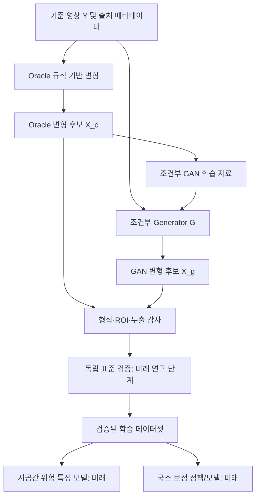

# LUMI 연구 설계서 v0.3

**부제: 통제된 시공간 영상 합성과 국소 수정 학습을 위한 재현 가능한 데이터 기반 연구**  
**작성 상태:** 연구 설계안(프로토타입) · 2026-11-04  
**적용 저장소:** `lumi-vision/lumi-lab-ryujungho2-collab` (개인 실험)  
**주요 연구 근거:** Barbu, Banda & Katz (2020) [R1]; Jordan (2025) [R2]; ITU-R BT.1702-3 (2023) [R3]; WCAG 2.2 SC 2.3.1 [R4].

> **연구 윤리 및 한계:** 본 문서의 '위험'은 기술 표준에 근거한 *광과민성 관련 시각적 위험 특성*을 뜻한다. 신경망 출력과 표준 기반 검사는 사람의 발작 확률 또는 개별 시청자의 의학적 안전성을 보증하지 않는다. 생성 클립은 **화면에서 자동 재생하지 않는다.** 미검증 영상의 사람 대상 시험은 수행하지 않는다.

## 초록(Abstract)

영상의 점멸, 포화 적색 변화, 반복적 고대비 공간 패턴은 광과민성 시청자에게 문제가 될 수 있다. 그러나 영상 전체에 동일한 감광·흐림 처리를 적용하면 위험 특성이 없는 영역의 색감과 질감까지 불필요하게 손상된다. LUMI는 **(1) 재현 가능한 시공간 변형 학습 데이터, (2) 위험 특성의 검증 가능한 시공간 분석, (3) 최소 개입 국소 보정 정책**을 별도 문제로 분해한다. 본 단계는 전체 시스템을 학습시키지 않는다. 통제된 Oracle 변형과 별도의 조건부 3D PatchGAN을 통해 원본–변형본 쌍을 생성하며, 변형 영역 주석의 정합성과 원본 단위 데이터 누출을 검증한다. 이 구조는 Barbu et al.의 Forward/Inverse 원리에서 영감을 받았으나, **원 논문의 GAN 및 광과민성 위험 평가기 재현이 아니다.** 향후 독립 표준 검사, 실제 비합성 시험 영상, 국소 보정 Teacher의 도입 여부를 실험적으로 판단한다.

**키워드:** photosensitive epilepsy, spatio-temporal augmentation, conditional GAN, local correction, reproducibility, distribution shift

## 1. 문제 정의

시간 `t`, 위치 `p=(x,y)`의 입력 영상을 `X_t(p)`라 하고, 보정 결과를 `Ŷ_t(p)`라 하자. 목표는 원본 내용과 움직임을 가능한 유지하면서 기술 표준 위반 또는 위험 관련 검사 지표를 줄이는 것이다.

$$
\min_{\theta}\; D_{\mathrm{visual}}(\hat Y, X) + \lambda_{\mathrm{local}}D_{\mathrm{outside}}(\hat Y,X)
\quad\text{subject to}\quad V_{\mathrm{independent}}(\hat Y;\,s,\,d) = \text{pass}
$$

여기서 `s`는 적용 기준 및 버전, `d`는 영상의 표시 조건이다. 이 식은 **추후 검증할 목표의 수학적 서술**이며, 현재 코드에 최적화기나 표준 검사기가 있다는 뜻이 아니다. `pass`는 기술 표준에 따른 판정을 의미할 뿐 임상 안전을 보증하지 않는다.

### 핵심 난점

1. **위험 특성의 정답은 객체 마스크와 다르다.** 같은 객체가 존재하더라도 시간에 따른 명암/색 변화에 따라 검사 결과가 달라진다.
2. **변형 영역과 위험 영역은 다르다.** 변형을 가했지만 임계값을 넘지 않은 샘플, 여러 작은 변형이 함께 작용하는 샘플을 구분해야 한다.
3. **원본이 절대적 안전 정답은 아니다.** `clean`은 변형 전 기준 프레임이지 공식 검사 통과가 검증된 '안전 영상'이 아니다.
4. **학습 점수만으로 기준 통과를 주장할 수 없다.** GAN 판별기·학습 손실·광과민성 기준 검사기는 별도의 판단기다.
5. **실시간 시스템은 미래 정보를 사용할 수 없다.** 사후 1초 윈도우 판정 결과를 현재 즉시 알 수 있다고 가정하는 평가는 정보 누출이다.

## 2. 연구 질문(Research Questions)

- **RQ1:** 규칙 기반 생성기만으로 구축한 합성 데이터와 규칙+GAN 합성 데이터는 외부 원본 영상의 위험 특성 탐지 일반화에 차이를 만드는가?
- **RQ2:** 공간적으로 조건화된 합성은 전역 변형보다 실제 국소 영역 보정에 필요한 데이터 다양성을 제공하는가?
- **RQ3:** `M_edit`(변형 허용 영역)와 별도로 검증된 `M_risk`(기준 관련 위험 기여 후보 영역)를 관리하면 위험 영역 누락과 과잉 개입을 줄일 수 있는가?
- **RQ4:** 위험 특성 감소를 동일하게 맞췄을 때 국소 필터 정책은 전역 감광·블러보다 정상 영역의 영상 품질을 더 보존하는가?

이 네 질문에 대한 **수치 결과는 아직 없다.**

## 3. 방법: 역할을 분리한 두 갈래

### 왜 이 순서인가?

- **Oracle 우선:** 통제 가능한 변형 위치·유형·시간 파형·시드를 알 수 있어 원인-결과 관계를 추적하기 쉽다.
- **GAN은 비교군:** GAN은 더 다양한 분포를 생성할 *가능성*이 있으나, 데이터 다양성 및 외부 영상의 성능 개선은 실험으로 입증해야 한다.
- **독립 검증 별도:** Oracle이 지정한 변형 유형과 GAN 출력이 곧바로 표준 위반/비위반 라벨이 되지는 않는다.
- **Inverse는 분리:** 생성 데이터를 이용한 보정 알고리즘 학습은 `M_risk`와 보정 목표가 확보된 후에 시작한다.

## 4. 데이터 용어를 엄격하게 정의

| 기호/필드 | 의미 | 현재 코드 상태 |
|---|---|---|
| `Y`, `clean` | 변형 전 기준 RGB 클립 | 구현 |
| `X`, `affected` | 통제된 변형 후보 RGB 클립 | 구현 |
| `M_allow`, `mask` | **변형을 허용하도록 지정한 영역** | 구현 |
| `M_changed` | 실제로 `X`와 `Y`의 픽셀 값이 다른 영역 | 별도 저장 안 함; 비교로 계산 가능 |
| `A_t`, `activation` | 시간별 변형 활성화 계수 | 구현 |
| `M_risk` | 독립 검사/검수로 얻은 위험 기여 후보 공간 주석 | 미구현 |
| `V_standard` | 표준 버전/시청 조건이 반영된 검사 결과 | 미구현(`not_evaluated`) |
| `Y*` | 보정 후보를 검증한 후 선택한 최소 개입 목표 | 미구현 |

`M_allow ≠ M_changed ≠ M_risk`일 수 있다. 예컨대 파형이 0인 프레임은 허용 영역 내부도 실제 변화가 없고, 변형 강도가 충분하지 않으면 위험 판정도 위반이 아닐 수 있다.

## 5. 표준과 시간 샘플링 제약

- ITU-R **BT.1702-3 (11/2023)**과 WCAG 2.2 SC 2.3.1을 *별개*의 평가 정책으로 관리한다 [R3, R4]. 하나의 단순 '3~30 Hz' 규칙으로 둘을 대체하지 않는다.
- 상대 휘도를 계산할 때는 색 전송 함수, 피크 휘도, 출력 화면 크기·점유 면적·시청 환경 가정을 기록해야 한다. 8비트 감마 인코딩 RGB의 평균값을 표준 휘도라고 부르면 안 된다.
- **현재 기본 클립 16프레임 @ 24fps는 약 0.667초**에 불과하다. 1초 구간을 검사하는 표준 이벤트 라벨을 이 클립만으로 확정할 수 없다. 검사기의 완전한 시간 구간을 별도로 확보해야 한다.
- 영상 자체의 FPS와 실제 표시 장치 주사율은 다르다. 고주파 특성은 샘플링·에일리어싱의 영향을 받는다. VFR에서는 실제 프레임 PTS 기반으로 시간축을 기록해야 한다.
- 표준 검사 통과를 발작 위험 '제거'로 표현하지 않는다.

## 6. 단계별 산출물과 완료 조건

| 단계 | 해야 할 일 | '완료'를 인정하는 증거 |
|---|---|---|
| V0 | 비디오 I/O 및 Oracle 합성 | 재현 가능한 `NPZ + JSONL`, ROI 보존 자동 검사 |
| V1 | 조건부 G/D 학습 | 손실 및 생성 통계, 모델 체크포인트와 설정, 실행 환경 |
| V2 | 독립 위험 검증기 연동 | 사용 도구/버전/표준/표시 가정 기록, 경계 사례 판정 검토 |
| V3 | GAN 기여 검증 | Oracle-only 대비 혼합 데이터의 독립 시험 성능 개선 및 신뢰구간 |
| V4 | 국소 수정 Teacher | 수정 영역·종류·강도를 탐색하고 표준 검사로 결과 확인 |
| V5 | 실시간 추론 | 입력~출력 전체 지연(p50/p95/p99), 오탐/미탐, 보호 경로 평가 |

**현재 검증 완료 범위:** V0 코드의 주요 불변식과 G/D 단일 학습 단계 테스트. V1은 학습 스크립트가 있으나 충분한 데이터로 수렴·효과가 검증된 상태는 아니다.

## 7. 연구 논문에서 주장할 수 있는 것과 없는 것

현재 말할 수 있는 사실은 '조건부 3D-CNN GAN으로 통제된 Oracle 영상 변형의 분포를 모사하도록 학습할 수 있는 코드가 있다'는 점이다. 학습 완료, 실제 영상 일반화, 공인 표준 적합성, 임상적 안전성, 60FPS 종단 지연 충족은 **현재 증거가 없다.**

가설의 채택 여부는 [실험 설계](EXPERIMENT_PLAN.md)에 따라 결정한다. 학술 기여는 새 모델 이름이 아니라 **투명한 데이터 주석, 검증 가능한 위험 감소와 정상 영역 보존의 균형, 재현 가능한 비교 실험**으로 확인한다.

## 참고문헌

[R1] Barbu, A., Banda, D., & Katz, B. (2020). *Deep video-to-video transformations for accessibility with an application to photosensitivity.* Pattern Recognition Letters, 137, 99–107. https://doi.org/10.1016/j.patrec.2019.01.019  
[R2] Jordan, J. B. (2025). *Evaluating Conformance of Video Safety Tools for Photosensitive Epilepsy.* HCII 2025, LNCS 15780, 85–98. https://doi.org/10.1007/978-3-031-93848-1_7  
[R3] ITU-R. (2023). *Recommendation BT.1702-3: Guidance for the reduction of photosensitive epileptic seizures caused by television.* https://www.itu.int/rec/R-REC-BT.1702-3-202311-I/en  
[R4] W3C. *Understanding SC 2.3.1: Three Flashes or Below Threshold (WCAG 2.2).* https://www.w3.org/WAI/WCAG22/Understanding/three-flashes-or-below-threshold.html
