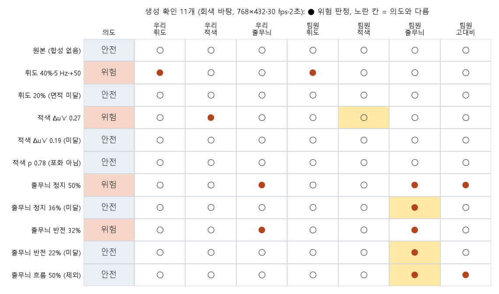
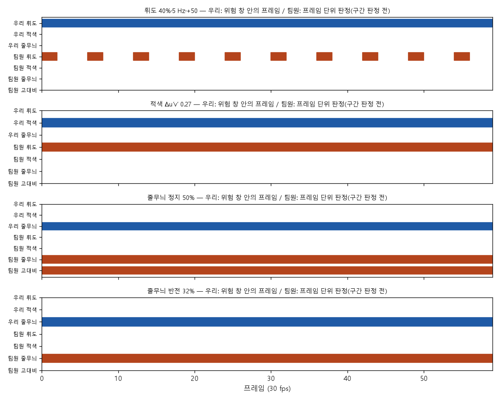

# Stage: 위험 3종(휘도·적색·줄무늬) 생성기 구축과 판정기 2종 검증

본 문서는 기존 오라클(휘도 깜빡임만 생성)을 **적색 깜빡임**과 **줄무늬 패턴**까지 넓혀, 판정 규칙의 각 조건을 의도한 대로
넘기거나 무너뜨리는 위험 영상을 만들 수 있는지 확인한 과정을 기록한다. 만든 영상은 우리 판정기(`lumi_synth.measure`)와
팀원 판별기(lumi-lab-rockrovks `e29ba9b`, `vdcoreops_v2.py`)로 각각 검사했다.

> ℹ️ 참고
> - 범위: 생성기(`src/lumi_synth/oracle.py`), 생성·평가 스크립트 3개, 테스트 1개. 판정기(`measure.py`)와 팀원 코드는 수정하지 않았다.
> - 합성 영상은 광과민성 위험 자극이라 **재생·미리보기하지 않았다.** 모든 확인은 판정기 수치와 수치 그래프로만 했다.
> - 팀원 판별기는 GitHub에 있는 최신 버전(`e29ba9b`, `vdcoreops_v2`)으로 돌렸다. 팀원 보고서 stage4의 새 패키지(`vdcore`, 시간 기준 적색 판정)는
>   저장소에 아직 올라오지 않아 시험하지 못했다.

## 1. 작업 경과

1. **생성기 확장** (2026-11-10, 커밋 `ba723c1`): `oracle.py`에서 휘도 깜빡임 그리기를 판정과 분리(`render_flicker`, 기존 결과와 동일)하고,
   적색 색 쌍(`red_pair`)·적색 깜빡임(`render_red`)·줄무늬(`render_stripes`)를 추가했다.
2. **조건 스윕 생성** (`make_hazard_sweep.py`): 조건 하나씩 판정 경계를 가로지르는 106개 조건을 만들었다. 회색 바탕 106개는
   노트북에서 생성했고, BBB 바탕은 원본(1080p)이 노트북에 없어 집 PC로 미뤘다.
3. **판정 범위 결정 반영**: 면적은 화면 비율 25%로 정했으므로(`docs/STANDARDS.md`) 위치·회전은 판정에 영향이 없다. 이번 확인에서는
   위치·회전을 빼고, 기준값 자체인 **면적**과 각 종류의 핵심 조건만 위험/안전 짝으로 확인했다.
4. **생성 확인 11개 평가** (2026-11-12): 종류별 위험 1개와 조건 하나만 무너뜨린 안전 1~2개를 골라 두 판정기로 검사했다
   (`eval_hazard_sweep.py --ids`), 결과 그림 2장을 만들었다(`plot_hazard_check.py`).

## 2. 파일별 역할

| 구분 | 파일 | 줄 수 | 핵심 심볼 | 역할·입출력 |
|---|---|---|---|---|
| 생성기 | `src/lumi_synth/oracle.py` | 346 | `wave`, `region_mask`, `render_flicker`, `render_flat_flash`, `red_pair`, `render_red`, `render_stripes`, `stripe_period_px`, `stripe_pairs_in_mask` | 바탕 클립(T×H×W×3 BGR uint8)과 마스크·조건을 받아 합성 영상을 돌려준다. 마스크 밖은 원본과 비트 단위로 같다. 판정은 하지 않는다. |
| 스윕 생성 | `scripts/make_hazard_sweep.py` | 251 | `specs`, `render`, `expect_lum`, `expect_red`, `expect_stripe` | 조건 106개 × 바탕(gray, bbb80)을 FFV1 무손실 영상으로 저장하고 `manifest.json`에 조건·설계상 기대·무너뜨린 조건을 기록. 기대는 판정기가 아니라 **조건값과 규칙**으로 계산. |
| 평가 | `scripts/eval_hazard_sweep.py` | 337 | `run_ours`, `run_team`, `report`, `--ids` | 저장된 파일을 다시 읽어 우리 `analyze_all`과 팀원 `analyze_video_frames`(수정 없이 기본 설정)를 돌리고, 클립별 결과를 `data/hazard_sweep/results/`에 캐시(중단 후 이어서 실행). |
| 그림 | `scripts/plot_hazard_check.py` | 93 | `main` | 생성 확인 11개의 판정 표와 프레임별 위험 표시 그림. |
| 테스트 | `tests/test_hazard_generators.py` | 56 | 7개 경우 | 적색 쌍의 Δu′v′·비율·휘도, 적색 판정 위험/안전, 줄무늬 주기·명암 반전, 마스크 밖 불변. |

## 3. 핵심 알고리즘

### 3.1 휘도 깜빡임 — 선형 빛 더하기

```
X_lin[t,p] = min(1, Y_lin[t,p] + M[p] · w(t) · ΔL / 200)
```

선형 RGB 세 채널에 같은 값을 더하면 상대 휘도가 정확히 그만큼 오른다(가중치 0.2126 + 0.7152 + 0.0722 = 1). 그래서 판정 조건
ΔL(cd/m²)을 직접 조절한다. w(t)는 사각파·사인파·삼각파 중 하나다(1주기 = 깜빡임 1번).
'어두운 쪽 < 160 cd/m²' 조건 시험용으로 영역을 단색 회색 L ↔ L+30으로 덮는 `render_flat_flash`도 두었다.

### 3.2 적색 깜빡임 — 같은 휘도의 색 쌍

- A(빨강): 선형 (r, g, g), 비율 ρ = r/(r+2g). 휘도 Y가 주어지면 `r = Y / (0.2126 + 0.7874·(1−ρ)/(2ρ))`.
- B: `B = (1−s)·A + s·파랑(같은 Y)`. 선형 혼합은 휘도를 보존하므로 **휘도 깜빡임 없이 색만 바뀐다.**
- u′v′는 XYZ의 사영변환이라 선형 혼합은 u′v′ 위에서 직선이 되고, Δu′v′는 s에 단조 증가한다. 그래서 s를 이분 탐색하되,
  8비트로 양자화한 뒤 **판정기의 `red_state`로 잰 Δu′v′**가 목표에 가장 가깝게 맞춘다.
- 휘도는 Y = 0.06(12 cd/m²)으로 정했다. 0.15에서는 색역 한계 때문에 청록·초록 쪽으로 Δu′v′를 0.13~0.30까지밖에 못 올린다.
  0.06에서는 ρ 0.6~0.95 전 범위에서 0.33 이상까지 만들 수 있다(2026-11-10 계산).

| 목표 (ρ, Δu′v′) | A (R,G,B) | B (R,G,B) | 잰 Δu′v′ | A·B 휘도 (cd/m²) |
|---|---|---|---|---|
| 0.85, 0.27 | 127, 37, 37 | 100, 27, 158 | 0.2695 | 11.94 / 11.92 |
| 0.85, 0.19 | 127, 37, 37 | 113, 32, 124 | 0.1906 | 11.94 / 12.00 |
| 0.78, 0.25 | 119, 45, 45 (포화 아님) | 95, 34, 158 | 0.2497 | 11.98 / 12.09 |

### 3.3 줄무늬 — 시야각 기준 사각파

- 주기(px) = `pixels_per_degree(W, H, θ) / cpd` (56 cm·15인치 16:9 화면, 판정기와 같은 식). θ는 줄에 수직인 방향이다.
- 픽셀마다 4×4 부분 표본으로 밝은 줄이 덮는 비율을 구해 **선형 빛으로 섞는다.** 높은 cpd에서 명암이 줄어드는 현상도 그대로 나타난다.
- 움직임: 정지 / 반전(hz로 명암 반전) / 흐름(°/s로 한 방향 이동). 정지·반전은 상태가 1~2개뿐이라 한 번만 계산해 재사용한다
  (클립당 약 30초 → 수 초).
- 설계상 쌍 수 = 마스크가 줄 수직 방향으로 차지하는 길이 ÷ 주기(`stripe_pairs_in_mask`).

## 4. 실행 방법과 산출물

```powershell
python scripts\make_hazard_sweep.py --backgrounds gray        # data/hazard_sweep/gray/*.mkv + manifest.json (재생 금지)
python scripts\eval_hazard_sweep.py --only team --team-dir <lumi-lab-rockrovks> --ids <id,...>
python scripts\eval_hazard_sweep.py --only ours --ids <id,...>
python scripts\plot_hazard_check.py                           # checks/hazard_sweep/fig_check_*.png
```

| 산출물 | 위치 | Git |
|---|---|---|
| 합성 영상, 마스크, manifest | `data/hazard_sweep/` | 제외 (위험 자극·용량) |
| 클립별 판정 결과 JSON | `data/hazard_sweep/results/` | 제외 |
| 판정 표, 프레임별 그림 | `checks/hazard_sweep/fig_check_matrix.png`, `fig_check_frames.png` | 포함 |

## 5. 검증 결과

### 5.1 단위 테스트

전체 `pytest` 89 passed, 4 skipped(pse-test-media 없음). 생성기 테스트 7개 경우가 모두 통과했다.

### 5.2 생성 확인 11개 (회색 바탕 sRGB 128, 768×432·30 fps·60프레임)



| 클립 | 의도 (무너뜨린 조건) | 우리 판정기 측정값 | 우리 | 팀원 |
|---|---|---|---|---|
| 원본 | 안전 (합성 없음) | 전이 0 | ✅ 안전 | 안전 |
| 휘도 40%·5 Hz·+50 | 위험 | 5회/초, 면적 39.7% | ✅ 휘도 위험 | 휘도 위험 |
| 휘도 20% | 안전 (면적) | 면적 19.8% | ✅ 안전 | 안전 |
| 적색 Δu′v′ 0.27 | 위험 | 5회/초, 면적 39.7%, Δu′v′ 0.269 | ✅ 적색 위험 | ❌ 적색 없음 |
| 적색 Δu′v′ 0.19 | 안전 (색 차이) | 적색 전이 0 | ✅ 안전 | 안전 |
| 적색 ρ 0.78 | 안전 (포화 빨강 아님) | 적색 전이 0 | ✅ 안전 | 안전 |
| 줄무늬 정지 50% | 위험 | 면적 50.2%, 정지, 1.0초 | ✅ 줄무늬 위험 | 줄무늬 위험 (+고대비) |
| 줄무늬 정지 36% | 안전 (면적 ≤ 40%) | 면적 36.2%, 정지 | ✅ 안전 | ❌ 줄무늬 위험 |
| 줄무늬 반전 32% | 위험 | 면적 32.3%, 반전, 1.0초 | ✅ 줄무늬 위험 | 줄무늬 위험 |
| 줄무늬 반전 22% | 안전 (면적 ≤ 25%) | 면적 22.2%, 반전 | ✅ 안전 | ❌ 줄무늬 위험 |
| 줄무늬 흐름 50% | 안전 (흐름 제외) | 면적 50.2%, 흐름 분류, 휘도 전이 0 | ✅ 안전 | ❌ 줄무늬 위험 (+고대비) |

- **우리 판정기: 11/11 의도와 일치.** 측정 면적이 마스크 면적과 0.5%p 안에서 맞았다(측정/마스크: 39.7/39.7, 50.2/49.7, 32.3/32.0, 36.2/35.8, 22.2/22.0).
  다른 종류로 번진 판정도 없었다. 적색 깜빡임은 휘도 위험이 아니었고, 흐름 줄무늬는 결정 A로 휘도에서도 빠졌다.
- **팀원 판별기(구버전 v2): 7/11.** 어긋난 4개의 원인은 다음과 같다.
  - **적색(1개):** 같은 프레임 안 빨강 대 주변 색의 차이를 본다. 회색 바탕과 빨강의 차이가 0.2를 넘지 않아 적색 프레임이 0/60이었다.
    팀원 stage4 보고서의 새 버전은 시간 기준(참조 프레임 대비 Δu′v′)으로 바뀌었다고 하므로 새 버전으로 다시 확인할 필요가 있다.
  - **줄무늬(3개):** 줄무늬 면적 기준을 정지·반전 모두 25%로 쓰고 흐름 제외가 없어, 정지 36%·반전 22%·흐름 50%를 위험으로 판정했다.
    팀원 stage3·4 보고서에는 정지 패턴 > 40%·6쌍 이상으로 적혀 있어 새 버전에서는 결과가 다를 수 있다.



- 우리는 위험 창 안의 프레임을, 팀원은 구간 판정 전 프레임 단위 판정을 표시했다. 팀원 휘도 프레임 판정은 5 Hz 켜짐 프레임마다
  나타나고 구간 판정에서 휘도 플래시로 묶였다. 적색 클립에서는 팀원의 휘도 프레임 판정이 60/60으로 켜져 있지만, 바뀌지 않아
  구간이 되지 않았다(회색 43 cd/m²가 평균의 1.3배 이상인 픽셀 60%).

### 5.3 판정 시간 (노트북 CPU)

| 판정기 | 클립당 시간 |
|---|---|
| 우리 `analyze_all` | 45~97초 (휘도·적색), 104~248초 (정지·반전 줄무늬), 570초 (반전 32%), 834초 (흐름 50%) |
| 팀원 `analyze_video_frames` (CPU, torch 2.15 cpu) | 44~93초 |

우리 판정기의 줄무늬 판정이 가장 느리다(STATUS 이슈 1번). 줄무늬가 화면에 계속 있는 클립일수록 오래 걸린다.

## 6. 한계와 다음 할 일

1. **바탕이 균일 회색뿐이다.** 실제 장면(BBB) 바탕에서는 시연 영상 때처럼 줄무늬 면적이 과대 측정될 수 있다(50→58%). 집 PC에서
   BBB 1080p를 받아 같은 11개와 106개 스윕 전체를 돌린다(`docs/HOME_NEXT_STEPS.md` 맨 위).
2. **아직 생성하지 않은 정의:** 줄무늬 쌍 수(5 또는 6, 면적과 얽혀 따로 바꾸기 어려움), 체커보드·동심원·방사형, 지속(연장) 플래시.
3. **팀원 새 판별기(`vdcore`)로 재검사:** 저장소에 올라오면 같은 11개로 다시 비교한다.
4. **규칙 기반 생성의 한계:** 위험 모양(사각형 영역, 단색 교대, 사각파 줄무늬)을 규칙에서 역으로 설계했다. 실제 위험 영상과
   닮았는지는 별도 문제다. 이를 위한 문헌 조사(반응 곡선, 실제 사건 영상)는 2026-11-11 사용량 한도로 중단되어 다시 시작해야 한다.
